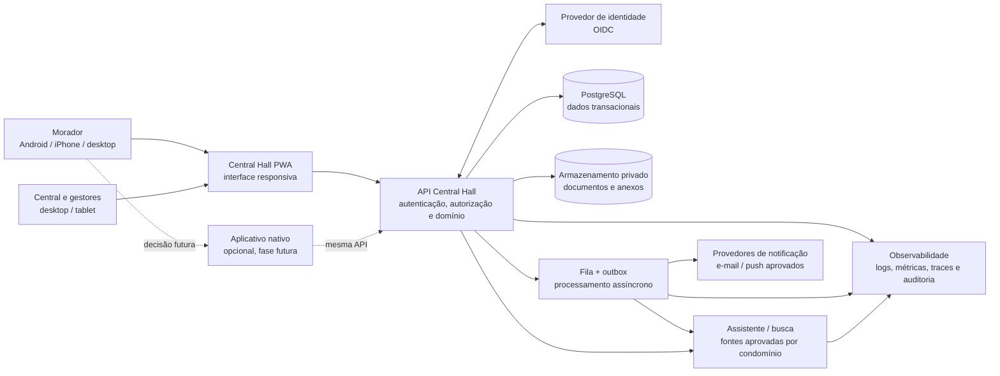
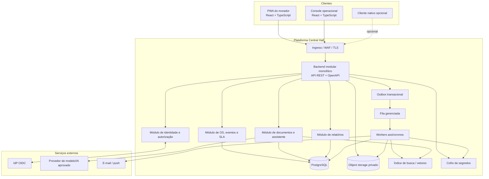

# Arquitetura da Solução — Central Hall

**Versão:** 1.0 · **Data:** 03/10/2026 · **Status:** proposta de arquitetura para validação  
**Escopo:** aplicação web responsiva, experiência móvel Android/iPhone, API e serviços do Central Hall

## 1. Resumo executivo

Recomenda-se iniciar com uma **Progressive Web App (PWA) responsiva**, instalável onde o navegador/sistema operacional oferecer suporte, para a experiência do morador; um console web responsivo atende central e gestores. Ambos consomem a mesma API segura. Assim, o morador usa o serviço no navegador de Android e iPhone sem depender da publicação inicial em lojas. Os fluxos essenciais permanecem disponíveis também sem instalação.

Para a primeira versão, recomenda-se um **backend modular monolítico**, com API REST versionada, PostgreSQL, armazenamento privado de objetos e processamento assíncrono por fila/outbox. Essa arquitetura reduz complexidade operacional sem impedir extração futura de componentes. A assistente de conhecimento é uma integração isolada por adaptador, subordinada a documentos publicados e ao escopo do condomínio.

Uma PWA não equivale a aplicativo nativo: instalação, notificações, execução em segundo plano, armazenamento offline e integração com recursos do aparelho variam entre versões de Android/iOS e navegadores. Se a publicação em App Store/Google Play, notificações móveis garantidas, uso offline avançado ou integração nativa forem obrigatórios, deve-se adicionar um cliente nativo (recomendação: React Native) consumindo a mesma API. Validar essa decisão com produto antes do início da implementação móvel.

## 2. Objetivos e princípios

- Permitir que moradores utilizem Android, iPhone, tablet e computador com interface adaptável.
- Manter separadas experiência do morador e operação, com autorização aplicada no servidor.
- Impedir cruzamento de dados entre condomínios em UI, API, banco, arquivos, fila, busca semântica e telemetria.
- Preservar rastreabilidade de OS, estados, configurações, conteúdo publicado e ações administrativas.
- Tratar IA, notificações e integrações externas como dependências substituíveis, não como autoridade sobre os dados.
- Preferir simplicidade evolutiva: monólito modular primeiro; microserviços somente diante de necessidade mensurável.
- Atender acessibilidade, privacidade, segurança, observabilidade e recuperação desde o desenho.

## 3. Escopo funcional suportado

Morador: autenticar-se, selecionar contexto autorizado, abrir OS, consultar histórico, acompanhar atualizações, consultar conhecimento e solicitar atendimento humano. Central: fila, triagem, atribuição, transições, comunicação, indicadores e relatórios. Gestor: parâmetros de condomínio, SLA e publicação/versionamento de conhecimento. Administrador da plataforma: gestão segregada de clientes e suporte auditado.

Pagamentos, reservas, controle de acesso físico, integrações com ERP/portaria/fornecedores e aplicativos publicados em lojas não são presumidos no MVP. Cada integração ou módulo deve ser aprovado e ter requisitos próprios.

## 4. Diagrama de contexto

## 5. Diagrama de contêineres e responsabilidades

## 6. Componentes e limites

### 6.1 Clientes web e móveis

- **PWA do morador:** experiência mobile-first; instalação opcional; manifesto, ícones, service worker e política de cache seguros. Não armazenar no cache respostas pessoais sensíveis nem permitir mutações offline ambíguas.
- **Console:** aplicação web responsiva para operadores e gestores; tabelas utilizáveis em tablet, com filtros, paginação e controles acessíveis.
- **Compartilhamento:** componentes visuais, tokens de design e validações simples podem ser compartilhados entre áreas; regras de negócio e autorização permanecem no backend.
- **Nativo futuro:** React Native (ou tecnologia aprovada pela organização), com clientes iOS/Android consumindo API e contratos comuns. Não duplicar regras no app.
- **Compatibilidade:** definir versões suportadas de Safari/iOS, Chrome/Android e navegadores desktop; validar login, uploads, layouts, notificações e instalação em dispositivos reais.

### 6.2 Backend modular monolítico

Um deploy lógico inicial, separado em módulos com dependências explícitas:

1. Identidade, membership, papel e autorização por tenant/unidade.
2. Condomínios, unidades, locais, categorias e configurações versionadas.
3. OS, histórico, atribuição, comentários e máquina de estados.
4. SLA, calendários e cálculo de prazos.
5. Documentos, ingestão, publicação, indexação e assistente.
6. Notificações, relatórios e exportações.
7. Auditoria, administração e integrações.

Aplicar princípios de arquitetura hexagonal: domínio independente de framework e provedores; adaptadores para IdP, banco, armazenamento, fila, IA e notificações. Não iniciar com microserviços sem evidência de escala, limites de equipe ou isolamento operacional que justifiquem o custo.

### 6.3 API e integração

API REST versionada (`/v1`), descrita por OpenAPI, HTTPS apenas, validação server-side, paginação por cursor, códigos de erro estáveis, correlation ID, `ETag`/versão em atualizações concorrentes e chave de idempotência para comandos de criação. Autenticação OIDC; autorização avaliada por request e recurso. Não confiar em IDs de tenant, estado ou papel enviados pelo cliente.

### 6.4 Persistência e processamento

- PostgreSQL para OS, histórico, memberships, configuração versionada, conversas e auditoria, com FKs, restrições e índices.
- Armazenamento de objetos privado para documentos/anexos, com URLs assinadas de curta duração quando necessárias, verificação de tipo/tamanho e malware.
- Outbox gravada na mesma transação de negócio; workers consomem fila com retries limitados, dead-letter e idempotência.
- Busca textual/vetorial atrás de interface substituível. Aplicar filtro de condomínio e elegibilidade documental antes de disponibilizar trechos à geração.
- Cache apenas para conteúdo apropriado, com chaves incluindo tenant e invalidação definida; nunca tratar cache como fonte de verdade.

## 7. Fluxos arquiteturais críticos

### 7.1 Criar OS

Cliente autentica via OIDC → API valida identidade e membership → verifica escopo da unidade/local, entrada, limite e idempotency key → transação grava OS, evento inicial, instâncias de SLA e outbox → resposta confirma registro persistido → worker envia notificação/atualiza projeções. Em falha antes do commit, não há sucesso aparente; em timeout após commit, repetição com a mesma chave retorna a OS existente.

### 7.2 Consultar na assistente

Cliente autenticado → API determina tenant pela sessão/membership → serviço de conhecimento filtra documentos publicados e vigentes daquele tenant antes da busca → resposta recebe referências e verificações de segurança → se evidência insuficiente, informar limite e oferecer handoff. O serviço de IA não pode alterar OS/configuração nem acessar dados de outro condomínio.

### 7.3 Publicar documento

Upload privado → validação e varredura → extração/indexação assíncrona em rascunho → aprovação por usuário autorizado → publicação versionada → indexação confirmada no escopo correto → retirada invalida cache/índice e torna documento inelegível. Erros de extração/indexação ficam visíveis e não são reportados como publicação concluída.

## 8. Segurança, privacidade e confiança

- OIDC com MFA conforme risco e política; sessão segura, proteção contra CSRF quando baseada em cookies, expiração e revogação.
- RBAC combinado com atributos de contexto (tenant, unidade, relação com OS); menor privilégio e auditoria administrativa.
- Defesa contra IDOR/BOLA em cada recurso; testes negativos entre tenants obrigatórios. RLS no banco é defesa em profundidade, não substitui autorização na aplicação.
- TLS, criptografia gerenciada em repouso, gestão/rotação de segredos e não exposição de segredos no cliente.
- CSP, escape contextual, sanitização de conteúdo renderizado e proteção contra XSS, injeção, abuso, brute force e uploads maliciosos.
- Minimização e classificação de dados pessoais; base legal, finalidade, transparência, direitos, retenção e descarte a serem aprovados pelo controlador/encarregado segundo LGPD.
- IA: isolamento de retrieval, fontes citadas, proteção contra prompt injection, sem ações privilegiadas, limiar/abstenção testados, revisão humana quando aplicável e política de retenção de prompts definida.
- Auditoria append-only de transições, alterações de configuração/publicação, acessos excepcionais e exportações; logs operacionais sem conteúdo pessoal desnecessário.

## 9. Requisitos de qualidade arquitetural

| Atributo | Meta inicial / decisão requerida |
|---|---|
| Usabilidade móvel | Fluxos essenciais operáveis em largura de 320 CSS px até desktop; sem rolagem horizontal nos formulários |
| Acessibilidade | WCAG 2.2 AA nos fluxos prioritários; teclado, leitor de tela, foco, contraste e erros compreensíveis |
| Desempenho | Metas existentes RNF-006: P95 consulta ≤2 s e criação ≤3 s em carga nominal aprovada |
| Disponibilidade | Meta inicial de 99,5% mensal para API, sujeita a aprovação e definição de dependências/janelas |
| Recuperação | RPO/RTO ainda pendentes; backups criptografados e teste de restauração antes de produção |
| Escala | Paginação, índices, agregações e workers; dimensionar após perfil de volume/concorrência |
| Observabilidade | Métricas de produto/serviço, logs estruturados, tracing distribuído e alertas acionáveis |
| Compatibilidade | Matriz de versões Android/iOS/browser aprovada e executada em dispositivos reais |

## 10. Hospedagem e ambientes

Executar em provedor de nuvem aprovado pela organização, em região/residência de dados aprovadas. Não há evidência que permita escolher fornecedor, região ou serviços específicos. Separar desenvolvimento, homologação e produção; identidade, chaves, banco, storage, fila e IA segregados. Infraestrutura como código, deployment automatizado, migrações compatíveis, rollback e sem dados reais em desenvolvimento sem anonimização.

Topologia recomendada: CDN/WAF para assets estáticos; aplicação/API em serviço gerenciado de contêiner ou plataforma equivalente; PostgreSQL gerenciado com backup e HA conforme metas; storage privado; fila gerenciada; workers escaláveis; observabilidade central. Dimensionamento e HA dependem de RPO/RTO, volume, orçamento e contratos.

## 11. Decisão web/PWA versus nativo

| Necessidade | PWA responsiva | App nativo |
|---|---|---|
| Uso por navegador em iPhone e Android | Sim, sujeito a matriz suportada | Sim |
| Instalação na tela inicial | Disponibilidade e experiência variam por SO/navegador | Sim, via lojas/distribuição empresarial |
| Atualizações | Publicação web centralizada | Revisão/distribuição por plataforma |
| Push/background | Capacidades e permissões variam; testar em dispositivos/versões | Maior controle, ainda sujeito a permissões/provedores |
| Offline e recursos do aparelho | Limitados e dependentes do navegador | Mais amplos, com custo maior |
| Custo inicial/manutenção | Menor, um cliente principal | Maior, build, publicação e QA por plataforma |

**Recomendação:** PWA-first para colocar os fluxos essenciais ao alcance imediato de Android/iPhone; desenhar API, autenticação, navegação e contratos para cliente nativo futuro. A aprovação de lojas, push obrigatório ou offline deve ser um gate explícito de produto — não presumir que PWA satisfaz esses requisitos.

## 12. Plano de implementação arquitetural

1. **Decisões e validação:** aprovar papéis, estados, SLA, escopo móvel, provedor de identidade, hospedagem, retenção, metas e canais.
2. **Fundação:** repositórios, design tokens, PWA shell, OIDC, API versionada, banco/migrações, tenant isolation, CI/CD, observabilidade e auditoria.
3. **MVP operacional:** abrir/acompanhar OS, fila, atribuição/transição, SLA e notificações aprovadas.
4. **Gestão:** dashboard com métricas definidas, exportação auditada, configurações versionadas e administração.
5. **Conhecimento/IA:** fluxo de ingestão e revisão, retrieval filtrado, referências, abstenção e handoff; ativar somente após testes de segurança/qualidade.
6. **Expansão móvel:** instalar e validar PWA nos aparelhos-alvo; iniciar cliente nativo apenas se requisitos não funcionais/negócio justificarem.

Cada fase deve atender critérios de aceite, autorização, acessibilidade, observabilidade, backup, teste e segurança antes de produção.

## 13. Decisões ainda necessárias

Confirmar requisitos de loja/PWA, navegadores e versões mínimas, IdP/MFA, cloud/região, disponibilidade/RPO/RTO, volume de condomínios/usuários/OS, canais de notificação, política de SLA/calendário, stack padrão da organização, provedor/modelo e retenção de IA, busca vetorial e governança LGPD. Essas decisões estão registradas com responsáveis sugeridos em `registro-decisoes-arquiteturais.md`.
