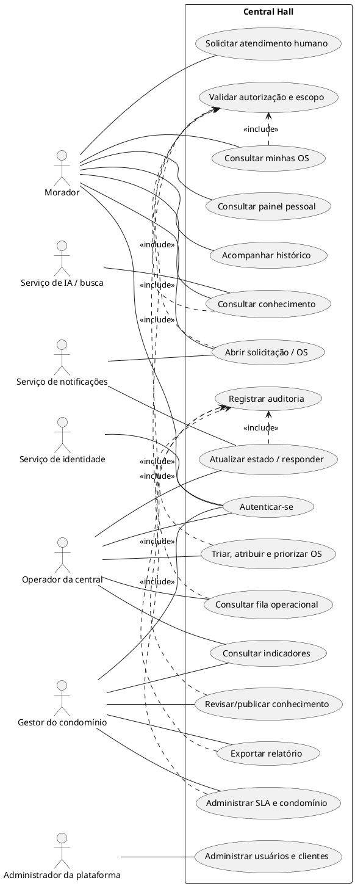
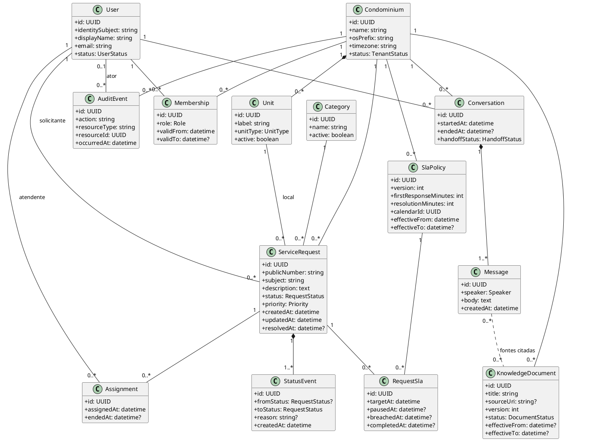
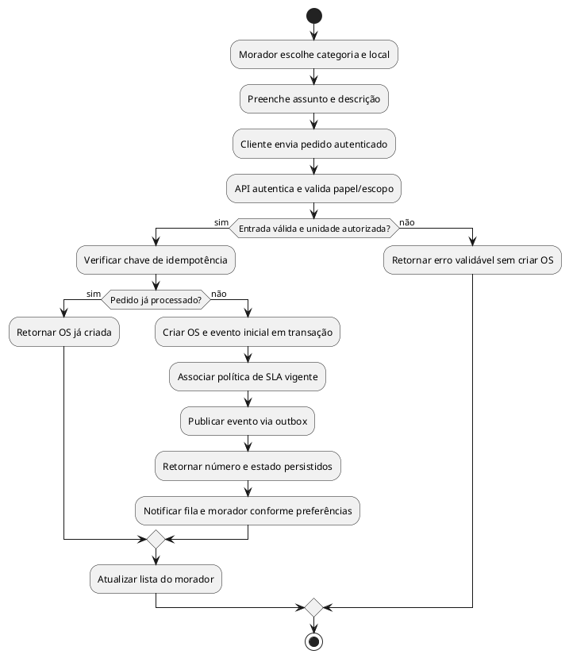
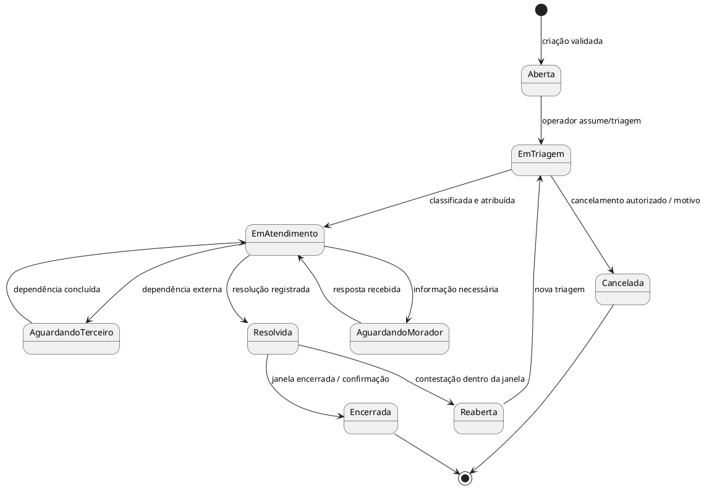
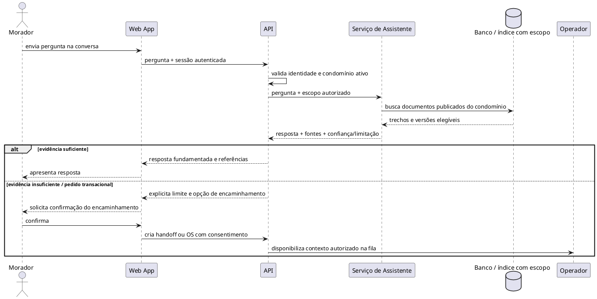

# Especificação UML — Central Hall

**Versão:** 1.0 · **Data:** 03/10/2026  
**Notação:** UML 2.x em PlantUML  
**Natureza:** modelo conceitual proposto a partir de protótipo; não representa classes já existentes no código.

## 1. Objetivo e fronteira

Os diagramas abaixo especificam a solução-alvo inferida: atores, casos de uso, entidades centrais, abertura de OS e ciclo de estados. O HTML implementa somente a alternância visual, abertura de modais, inserção de conteúdo em memória e respostas estáticas. Autenticação, serviços, regras, persistência e integrações nos diagramas são requisitos de sistema, não componentes observados.

## 2. Diagrama de casos de uso

## 3. Diagrama de domínio / classes

**Interpretação:** `Membership` determina acesso contextual, não a presença de um seletor de interface. `ServiceRequest` mantém referência ao solicitante e condomínio; unidade pode ser nula para ocorrência em área comum sem unidade individual, mediante regra aprovada. Histórico e auditoria são registros append-only para usuários normais. As cardinalidades definitivas dependem da política de cadastro, múltiplas unidades e solicitante externo.

## 4. Atividade — abertura de OS

## 5. Máquina de estados da OS

Estados e limites temporais são proposta. O protótipo não implementa transições; apresenta “Aberto”, “Novo” e “Em atendimento” como rótulos de exemplo. Antes da implementação, aprovar se `Encerrada` exige ação explícita, se `AguardandoMorador` pausa SLA e quais atores podem cancelar/reabrir.

## 6. Sequência — consulta assistida

## 7. Regras UML complementares

- Restrição de escopo: toda consulta/mutação de OS e conhecimento deve incluir autorização do condomínio no servidor.
- Restrição de identificador: `publicNumber` é único por condomínio (ou globalmente, conforme decisão), nunca chave estrangeira.
- Restrição temporal: versões de SLA/documento são não sobrepostas no intervalo de vigência quando a política exigir unicidade vigente.
- Restrição de estado: toda transição corresponde a evento histórico e valida a matriz de transições.
- Restrição de assistente: referências devolvidas devem apontar para fontes elegíveis e o filtro tenant é aplicado antes da busca/generation.

## 8. Rastreabilidade dos modelos

| Modelo | Requisitos |
|---|---|
| Casos de uso | RF-001–024 |
| Classes | RF-002–024 e modelo em `modelagem-de-dados.md` |
| Atividade de abertura | RF-005–009, RF-022–024 |
| Máquina de estados | RF-011–013 |
| Sequência da assistente | RF-017–021, RNF-013 |

## 9. Elementos não observáveis

Não se inferem do template serviços, classes, endpoints, autenticação, papéis, integrações, persistência, protocolo de chat, política de estado ou tecnologia UML existente. Diagramas documentam um desenho lógico a validar com stakeholders, e não reverse engineering de uma aplicação de produção.
